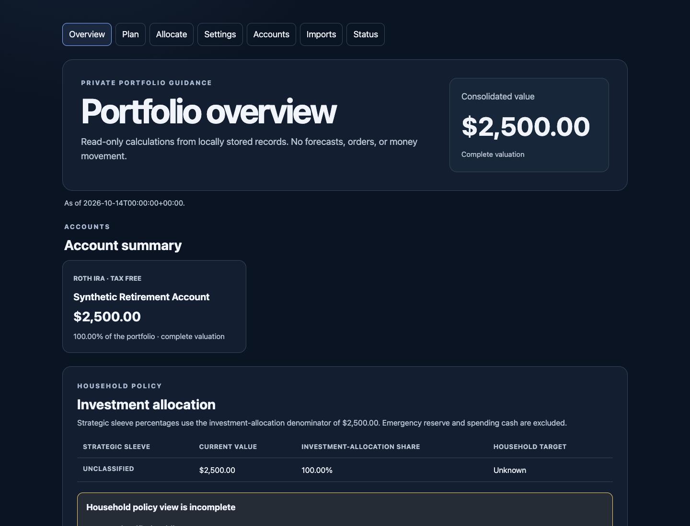
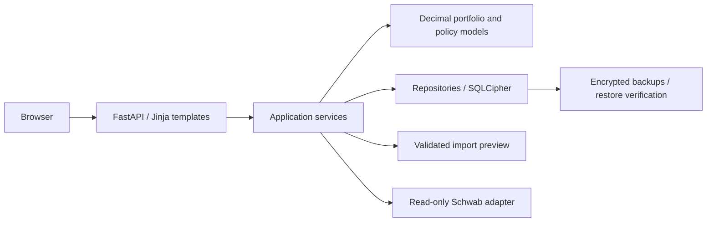

# Northstar Portfolio

A self-hosted portfolio dashboard that turns account holdings, cash flows, and allocation targets into read-only contribution guidance. Built with Python, FastAPI, server-rendered HTML, and an encrypted SQLCipher database.

This portfolio edition contains source code and synthetic tests only. Brokerage access is disabled by default; you can explore the application without provider credentials.



*Screenshot generated from synthetic holdings; no personal financial data.*

## What it does

- Tracks accounts, positions, tax lots, cash flows, and household allocation policies.
- Previews and validates position imports before committing them, with reconciliation and duplicate protection.
- Calculates allocation drift and inflow-only contribution guidance using fixed-scale Decimal arithmetic.
- Shows missing, stale, and incomplete inputs explicitly instead of treating unknown values as zero.
- Includes Schwab OAuth, account discovery, read-only balance/position snapshots, transaction ingestion, and pricing checkpoint code. Provider calls are constrained to an allowlist; there is no trade execution or money movement.
- Provides encrypted backups, isolated restore verification, retention, secondary replication, and operational health checks.

## Architecture



`northstar/domain` holds portfolio calculations and policy rules. `northstar/services` coordinates imports, guidance, and provider snapshots. `northstar/data` handles encrypted persistence and migrations. `northstar/integrations` contains provider clients; `northstar/operations` handles deployment and recovery. The web layer uses server-rendered templates with no client-side storage of financial records.

## Run locally

Requires Python 3.12 or later. The CI environment uses Python 3.13. Keep the runtime outside the checkout.

```bash
python3 -m venv .venv
.venv/bin/python -m pip install -e '.[dev]'
.venv/bin/python scripts/create_runtime.py --root ~/.northstar-portfolio
set -a
. ~/.northstar-portfolio/secrets.env
set +a
.venv/bin/uvicorn app:app --host 127.0.0.1 --port 8010
```

Open <http://127.0.0.1:8010>. Start with invented accounts and synthetic holdings. Local mode is for development on loopback; remote deployments require Cloudflare Access and secure cookies.

For Docker, set `NORTHSTAR_SECRET_FILE`, `NORTHSTAR_DATA_DIR`, and `NORTHSTAR_BACKUP_DIR` to the external runtime paths, then run `docker compose up --build`.

## Security and reliability decisions

- SQLCipher protects database pages; AES-GCM separately encrypts sensitive provider material. Keys and runtime data stay outside Git.
- Cloudflare Access assertions are validated by the application. Production enforces an exact configured host, HTTPS origin checks, secure sessions, and CSRF protection.
- Set `NORTHSTAR_PRODUCTION_HOSTNAME` in the external environment/secrets file. `northstar.example.com` is a documentation default; replace example hostnames in the Cloudflare runbook with your configured host.
- Backups are restored into an isolated temporary directory and verified before retention removes older recovery points.
- Git hooks and CI scan for likely secrets and financial exports. Scanners reduce exposure risk but cannot prove the absence of all sensitive content.

See [deployment and recovery](deployment/mac-mini/README.md), [Cloudflare deployment](deployment/mac-mini/CLOUDFLARE.md), and [Schwab integration design and limitations](docs/SCHWAB_INTEGRATION.md).

## Verification

```bash
.venv/bin/python -m pytest
.venv/bin/python -m ruff check .
./scripts/install_git_hooks.sh
.venv/bin/python scripts/scan_secrets.py --all
.venv/bin/python scripts/scan_secrets.py --history
```

The portfolio edition passes **566 tests** and Ruff lint checks. Tests cover encrypted storage, authentication and origin boundaries, CSRF, import validation, Decimal calculations, provider failure handling, checkpoint completeness, and backup/recovery behavior. Provider tests use synthetic inputs and mocked responses; passing them does not certify live brokerage behavior. CI also runs a dependency audit.

## Scope

This is a single-household engineering project. The deployment runbooks target a Mac mini and retain host-specific operational assumptions. Integration code is present, but live provider acceptance and production onboarding require separate operator validation. Guidance is informational and does not execute trades.

## License

[MIT](LICENSE).
